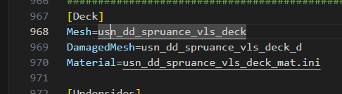
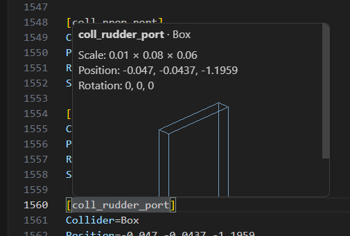
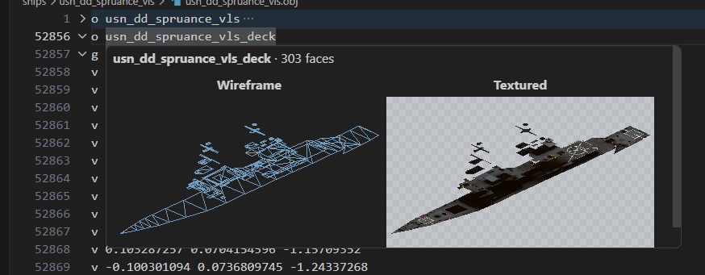
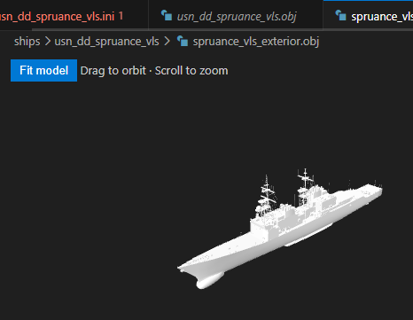
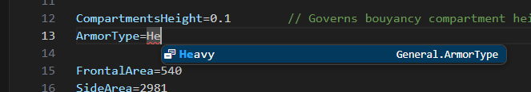
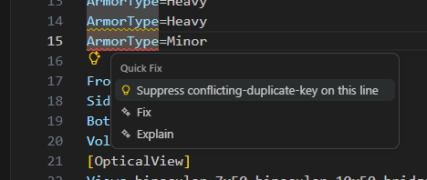

# Sea Power INI screenshots

Captured in VS Code with the stock Spruance VLS destroyer.

## Mesh and material links

## Wireframe and textured mesh

## Lit material and texture maps

## Mesh collider geometry

## Box collider shape and dimensions

## Mount and barrel definitions

## Object preview in OBJ source

## Collapsed OBJ objects

## Spruance VLS in the 3D preview

## Collapsed INI section

## Value completion

## Duplicate warning and conflicting-value error

## Diagnostic quick fix

## Same-line diagnostic suppression

## Commented INI section

## Read-only stock reference

## Spruance VLS in the FBX viewer

