# Sea Power INI screenshots

Captured in VS Code with the stock Spruance VLS destroyer.

## Mesh and material links

## Wireframe and textured mesh

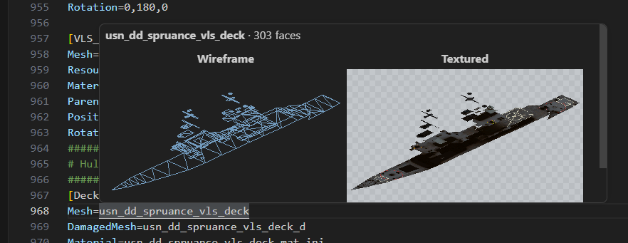

## Lit material and texture maps

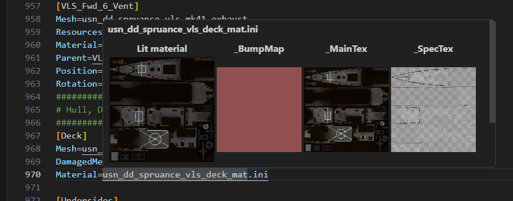

## Mesh collider geometry

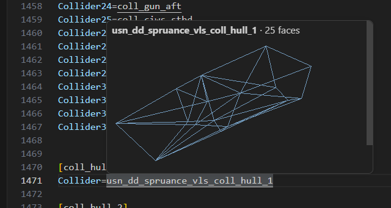

## Box collider shape and dimensions

## Mount and barrel definitions

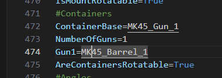

## Object preview in OBJ source

## Collapsed OBJ objects

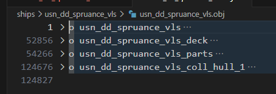

## Spruance VLS in the 3D preview

## Collapsed INI section

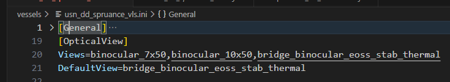

## Value completion

## Duplicate warning and conflicting-value error

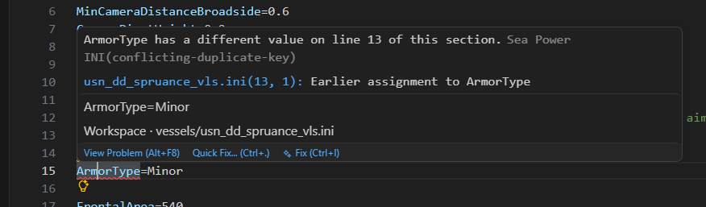

## Diagnostic quick fix

## Same-line diagnostic suppression

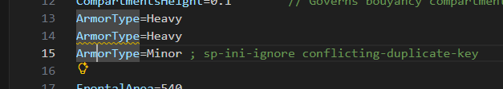

## Commented INI section

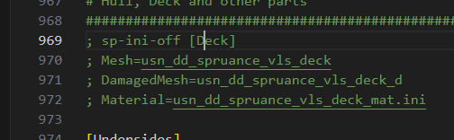

## Read-only stock reference

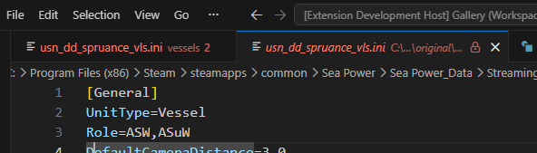

## Spruance VLS in the FBX viewer

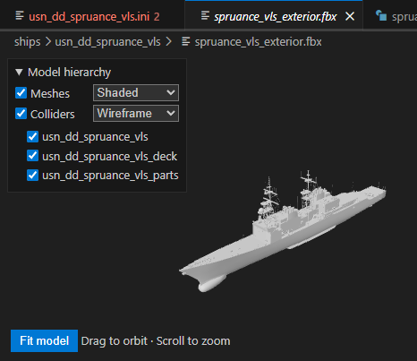

## Mesh tooltip on the assembled Spruance

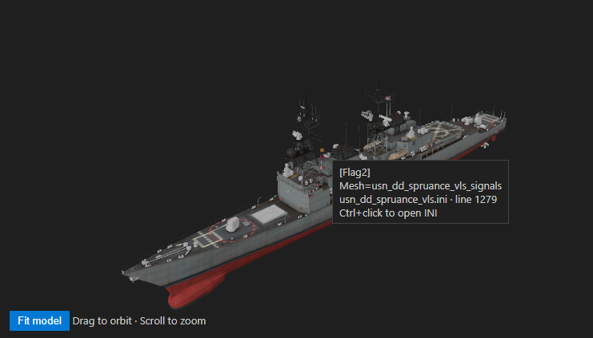

## Meshes, colliders and system markers on the Spruance

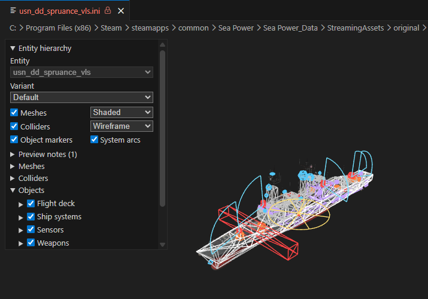

## Spruance VLS with wireframe colliders and system arcs

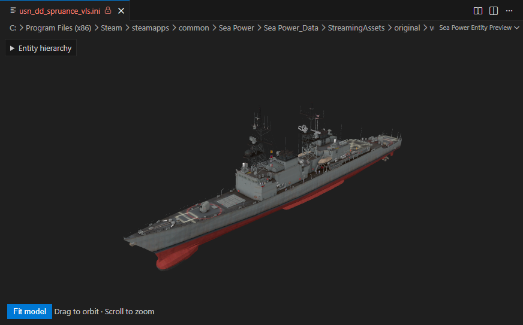

## Highlighted colliders with the weapon system first in the tooltip

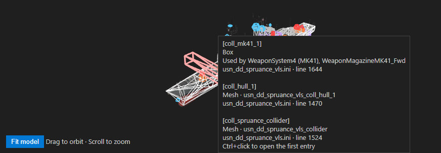

## Sphere collider wireframes and INI source tooltip

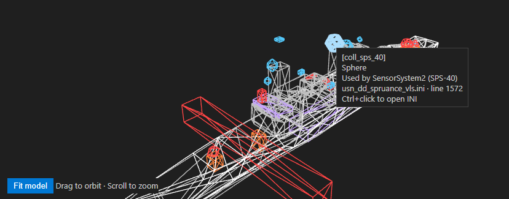

## Shift+click opens the collider definition beside the preview

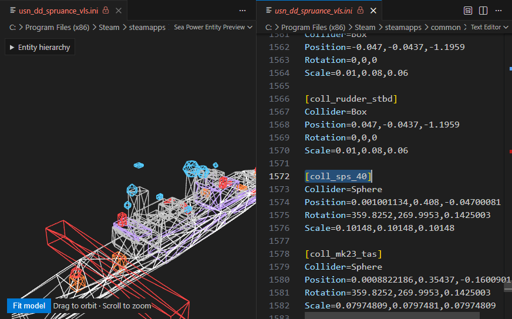

## Repeated mesh and its source template

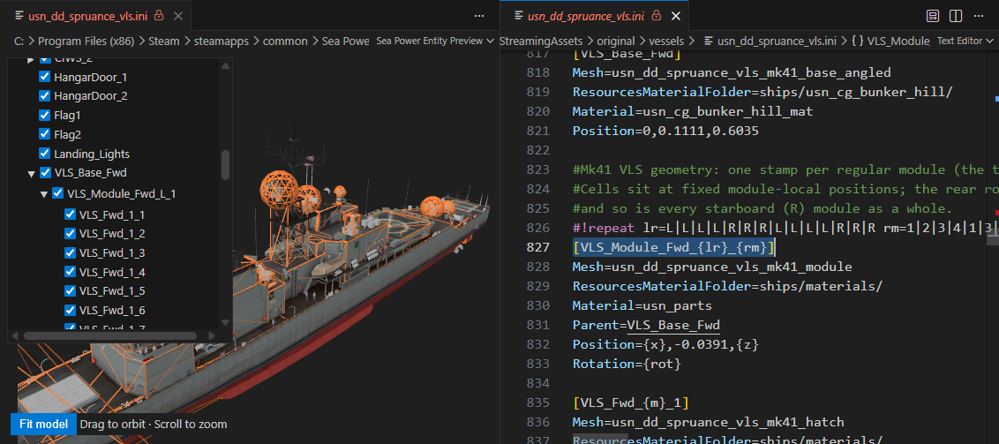

## Spruance VLS unit reference card

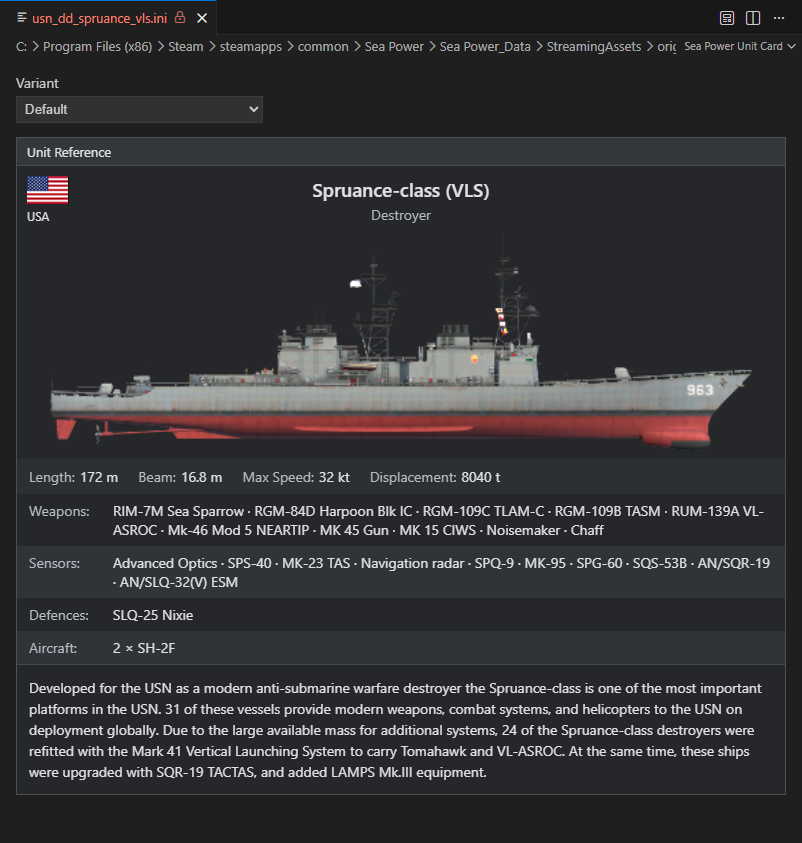

## Sensor reference linked from the Spruance unit card

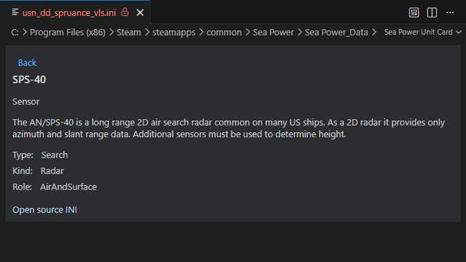

## Unit hints on the stock Victor K2

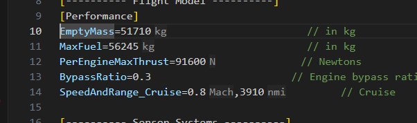

## Export INI

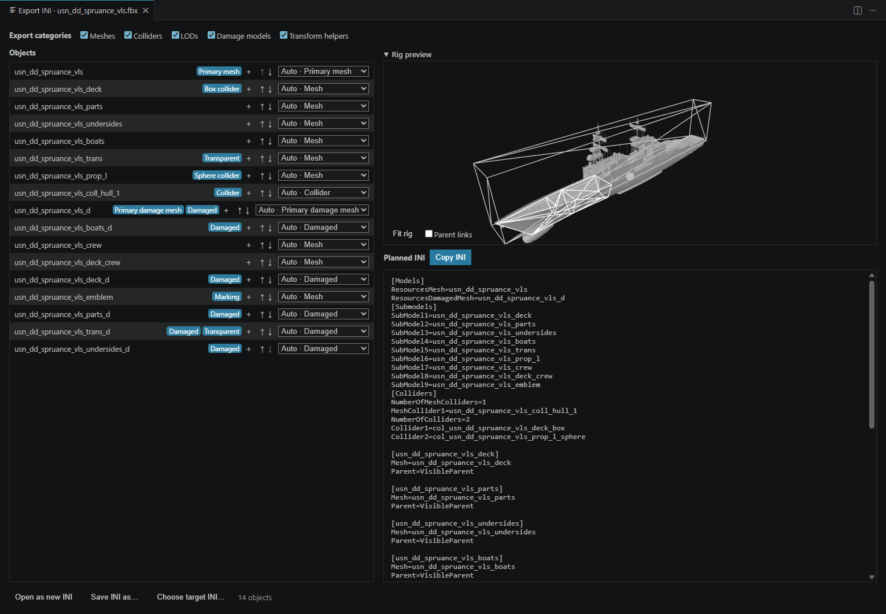

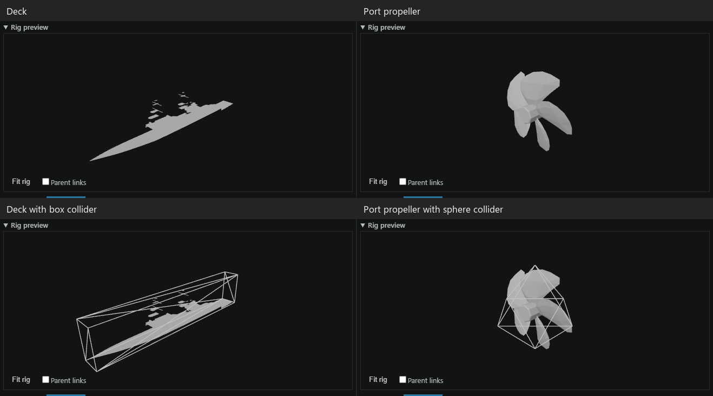

## Workspace analysis

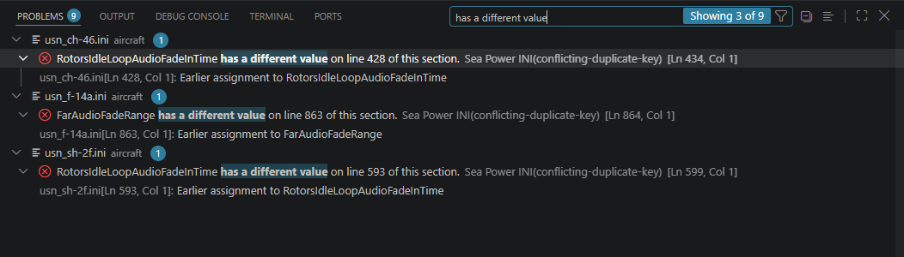

## Unity material preview

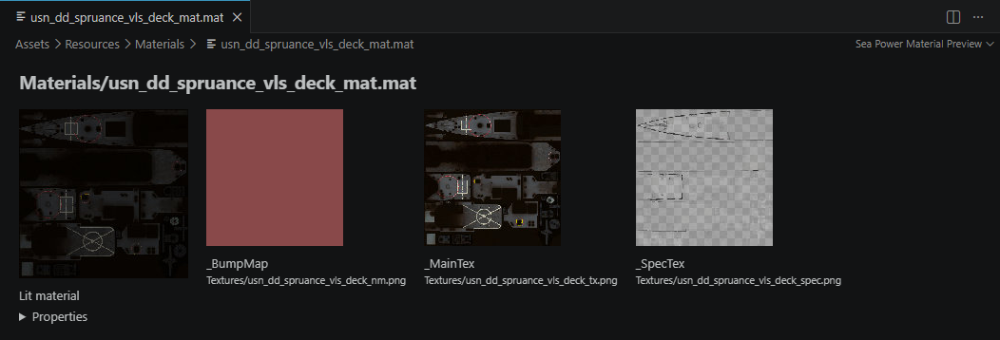

## Radar animation

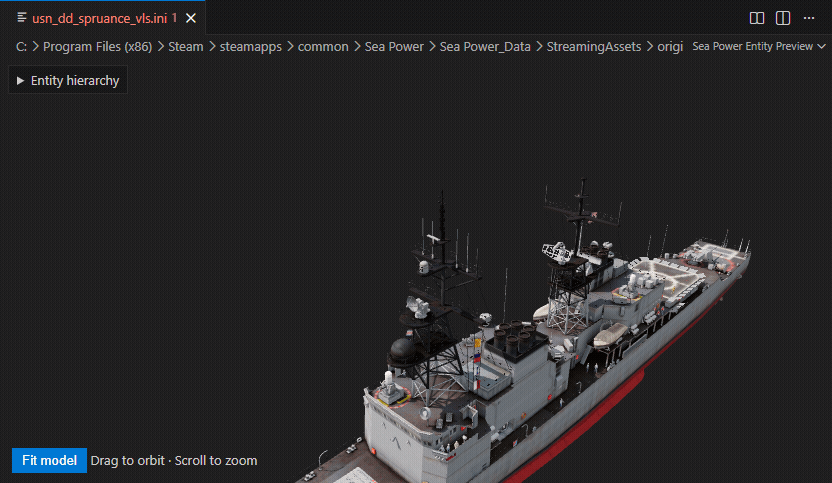
